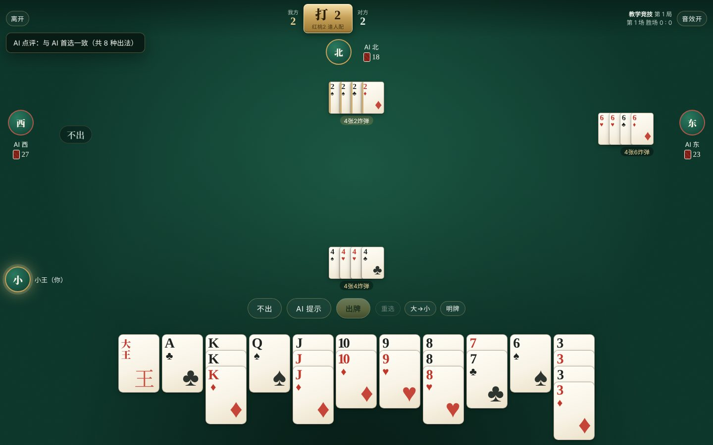
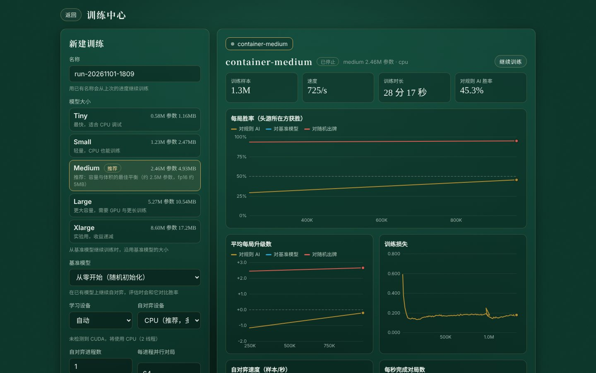
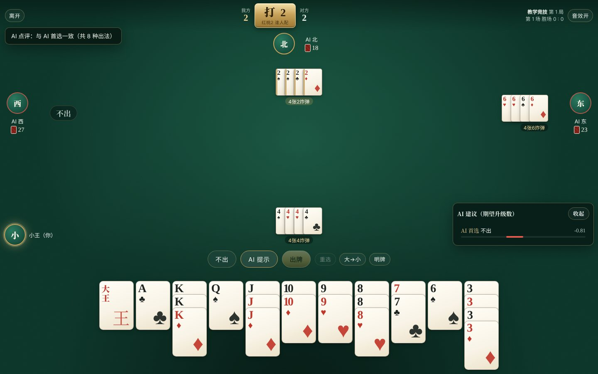
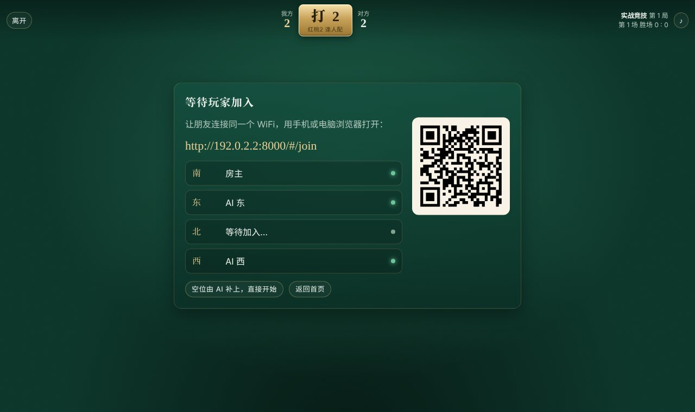
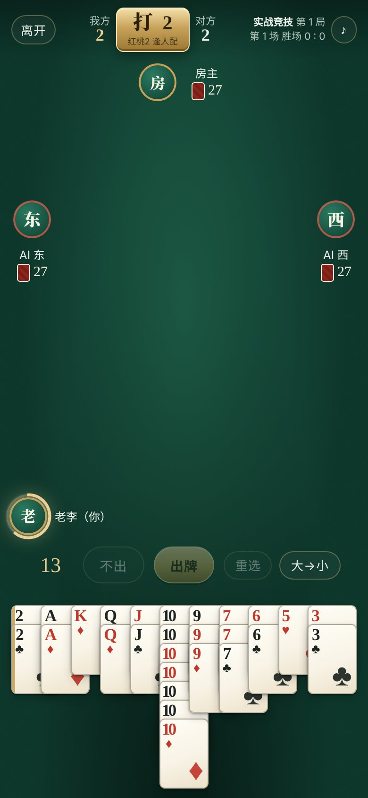

# Guandan AI (guandan-rl)

[中文](README.md) · **English**

A Guandan (掼蛋) AI trained purely by **self-play reinforcement learning**, with a browser-based Training center and card table: watch win-rate curves while you train models, learn from and play against the AI, and phones and computers on the same WiFi can join the same table.

The game interface is available in Chinese (default) and English. Switch with the "中文 / English" button at the top right of the home page; the choice is remembered separately for each browser/device.



## Features

- **Complete Guandan rules**: wild card (the heart of the level rank), triple with a pair, straights, three consecutive pairs, plates (steel plates), all kinds of bombs, straight flushes, the four-joker bomb, tribute / return tribute / resisting tribute, jie feng (partner takes the lead), double win (1st and 2nd out) advancing three levels, passing A, and falling back to 2 after failing to pass A three times. See the [rules (in Chinese)](docs/RULES.md).
- **Pure reinforcement learning**: Deep Monte Carlo (DMC) self-play, trained without any human game records or hand-written strategy. Each AI sees only its own hand and the public play history. The v1.10.2 network is a widened large model (5.5M parameters, 7.9 billion self-play decisions); on 30,000 unseen duplicate deals it gains +0.070 levels per round against v1.10.1 and +0.485 against v1.9.0 (57.7% of rounds), and wins 92.4% of rounds against the rule-based AI. See the [training guide (in Chinese)](docs/TRAINING.md) and the [model notes (in Chinese)](docs/MODEL.md).
- **Auxiliary-task training**: during training the network also predicts the other three players' hands (following the open-source DanLM / DanKS), which in testing wins about 0.4 more levels per game than plain training.
- **Rollout search (experimental)**: before playing, it randomly guesses the opponents' hands and rolls out the few moves the network likes best across 24 "possible worlds". It helps models that have only been trained briefly but is slightly worse for the bundled model, so it is off by default.
- **Duplicate evaluation**: during evaluation each deal is played twice with the two sides swapping seats, and error margins are reported, so differences between models are not drowned out by luck of the deal.
- **Score multipliers (optional in quick games)**: only the level-up / standard multiplier (bombs of 6+ cards, straight flushes and the four-joker bomb double the score) / every bomb doubles; the table shows the multiplier live.
- **High performance**: the rules engine, legal-move generation and feature encoding are all written in Rust (60,000–100,000 decisions per second on a single core), with PyTorch for the network; when a GPU is available, self-play and learning both run on the GPU (mixed precision, in-VRAM replay buffer).
- **Training center**: choose a model size (medium recommended, about 2.5M parameters, 5 MB), start from scratch or continue training from a baseline model, and watch live win-rate curves against the rule-based AI / baseline model / random play, plus loss and speed.
- **Play**
  - **Teaching mode**: you and three AIs. No time limit; the AI can give its top five move suggestions (with expected levels gained), it comments after each move you make, and you can reveal everyone's cards.
  - **Real-game mode**: any mix of AIs and humans. Each move has a 20-second limit, and on timeout a random legal move is played; you can't see others' cards, but once you are out you can see your partner's.
  - **Quick game** (random level rank, single-game scoring) or **competitive mode** (play from 2 up to A).
  - **LAN play**: others join by scanning a QR code or opening the URL on a phone or computer on the same WiFi.
  - **Android app**: install one app on your phone and play; the phone itself acts as the host, and friends scan the QR code and join from a browser.
  - **Pause anytime, multiple tables**: leaving the table (or sending the phone app to the background) pauses automatically, and you resume where you left off; you can run up to 8 tables at once and view, join, pause or close them all from the home page.
  - **Permissions**: the computer running the game is the host and manages all tables and the Training center; other devices can only manage the tables they opened. You can set a host password so a phone can also act as host.
- Dealing, plays, bombs, tribute, rankings and level-ups all have animations and sound effects, and it works on phones in both portrait and landscape.

| Training center | Teaching mode (AI hints) |
|---|---|
|  |  |
| **Waiting for players on the LAN (scan to join)** | **Playing on a phone (real-game mode, 20-second timer)** |
|  |  |

## Installation

### Windows portable version (play only, simplest)

Download `guandan_windows.exe` (about 32 MB) from [Releases](https://github.com/wlx7/guandan-rl/releases). Double-click to play and to host LAN games; no Python or other dependencies needed.

- It does not include PyTorch and runs the bundled model with numpy (its moves are identical to the full version), so it **cannot train**; for training use the full install below.
- Data (added models, model names) is kept in a `guandan_data` folder next to the exe. Put the exe in the full-install folder (for example `D:\guandan`) to play against models trained there.
- On first run Windows may say "Windows protected your PC"; click "More info → Run anyway". When the firewall asks, tick "Private networks" so phones can connect.
- Closing the black window quits the program. Each launch takes a few seconds to unpack.

### Android phone

Download `guandan_android.apk` from [Releases](https://github.com/wlx7/guandan-rl/releases) and install it (allow your browser to install apps from unknown sources). Open it to play against the AI; the phone itself is the LAN host, so friends on the same WiFi can scan the QR code and join from a browser without installing the app. Like the portable version, it can play but not train. See the [Android guide (in Chinese)](docs/ANDROID.md).

### Windows full install (can train)

1. Download `install_windows.bat`, `install_windows.ps1`, `start_windows.bat` and `train_windows.bat` from [Releases](https://github.com/wlx7/guandan-rl/releases) and put them in the same folder (for example `D:\guandan`).
2. Double-click `install_windows.bat`. It will automatically:
   - install [uv](https://github.com/astral-sh/uv) and Python 3.12. Since v1.5.1, Python, the download cache, the virtual environment (`.venv`) and the training data (`guandan_data`) **all live inside this folder** and won't use up your C: drive (the CUDA build of PyTorch is about 5 GB, so pick a drive with plenty of space);
   - detect an NVIDIA GPU and install the matching **CUDA build of PyTorch** (trying cu126 / cu124 / cu121 / cu118 in turn, switching to a China mirror automatically on failure, and installing the CPU build if there is no GPU);
   - install this program (including the trained model).
3. Double-click `start_windows.bat`; the browser opens `http://127.0.0.1:8000` automatically.

On first launch the Windows firewall asks whether to let Python access the network; tick "Private networks" so other devices on the LAN can connect. If SmartScreen blocks a `.bat` downloaded from the web, click "More info → Run anyway".

The installer's output is saved in `install_log.txt`. To upgrade when a new version comes out, just double-click `install_windows.bat` again (an already-installed PyTorch is skipped). To uninstall, delete the whole folder.

### Linux / macOS

```bash
python3 -m venv .venv && . .venv/bin/activate
pip install torch                      # 按 https://pytorch.org 选择合适的 CUDA 版本
pip install guandan_rl-*.whl           # 从 Releases 下载对应平台的 wheel
guandan serve
```

### Build from source

Requires Rust (`rustup`) and Python 3.9+:

```bash
git clone https://github.com/wlx7/guandan-rl && cd guandan-rl
pip install maturin torch
maturin build --release && pip install target/wheels/*.whl
guandan serve
```

## Usage

### LAN play

1. On the host, click "Open a table", choose **real-game mode**, set the seats for your friends to "Player", and click "Start table".
2. The table shows the LAN address and a QR code (for example `http://192.168.1.8:8000/#/join`). Friends connect to the same WiFi, scan the code with their phones or open the address in a browser, then pick a seat and enter a nickname to join.
3. Cards are dealt automatically once all players have arrived. The player opposite you is your partner.

If you get disconnected, reopening the page puts you back in your old seat.

### Playing cards

- Click cards in your hand, or **press and drag** across the hand to select several in a row; **double-click** a column to select every card of that rank; right-click or "Reselect" clears the selection.
- Enter = play, Space = pass, Esc = cancel selection.
- When a hand can be played in more than one way (for example 7 7 7 plus two wild cards can be a 5-card bomb or a triple with a pair), a prompt lets you choose.

### Training

Open the "Training center", choose a model size, baseline model and number of parallel processes, and click "Start training". Training runs in a background process, so closing the browser page doesn't affect it; starting again with the same name continues from the previous progress.

- **Each training run is its own folder**, `guandan_data/runs/<name>/` (the name defaults to the start time). Inside, `model.pt` is the latest model of this run (saved automatically every 5 minutes), `model_<samples>k.pt` are hourly snapshots, and `ckpt_latest.pt` is used to resume training.
- When you open a table, the "AI model" dropdown lists entries such as "Training <name>: model.pt" directly; click "Add to model library" to copy one and give it a memorable name.
- Your GPU and memory only support **one** training run at a time; you can't start a new one while another is running. The number of self-play processes and parallel games is limited automatically according to the machine's VRAM and memory.
- After you click "Stop training" the model is saved before exiting; if there is no response within 1 minute it is force-stopped, and you can also click "Force stop" manually.

For how the bundled model was trained, see the [model notes (in Chinese)](docs/MODEL.md).

You can also train without the UI, from the command line or by double-clicking `train_windows.bat`:

```bash
python -m guandan.train --name main --preset medium
```

### Command-line overview

```
guandan serve [--port 8000]         启动界面（默认监听所有网卡，供局域网访问）
guandan train ...                   训练（参数见 python -m guandan.train -h）
guandan eval model.pt --opponent rule --rounds 2000
guandan info                        显示 GPU、模型大小预设和已有模型
```

(`serve` starts the UI, listening on all network interfaces by default for LAN access; `train` trains, with options shown by `python -m guandan.train -h`; `eval` evaluates a model; `info` shows the GPU, model-size presets and existing models.)

Data (training records, model library) is saved in `~/guandan_data` by default; the one-click Windows install keeps it in the `guandan_data` folder of the install folder, and the portable version keeps it in the `guandan_data` folder next to the exe. You can change this with the `GUANDAN_HOME` environment variable.

## Project structure

```
src/                 Rust 规则引擎（PyO3 扩展 guandan._core）
  cards.rs           牌、级牌、逢人配、随机数
  moves.rs           牌型识别（含逢人配的所有解释）与合法出牌生成
  game.rs            整场比赛状态机：发牌、进贡还贡抗贡、接风、升级、过 A
  features.rs        观测编码（只用当前玩家可见的信息）
  venv.rs            批量环境（自对弈与评估）
  bot.rs             规则 AI（只用于评估，不参与训练）
python/guandan/
  model.py           Q 网络与模型大小预设
  train.py           DMC 自对弈训练（多进程 actor + GPU learner + 评估进程）
  evaluate.py        对战评估
  agents.py          推理封装
  server/            FastAPI + WebSocket 对战服务器与训练管理
  web/               前端（原生 JS，无需构建）
android/server/      安卓版的牌桌服务器（Rust：房间逻辑、HTTP/WebSocket、网络推理，与 Python 版协议相同）
android/app/         安卓外壳（全屏 WebView + 前台服务）
scripts/             Windows 一键安装 / 启动 / 训练脚本
tests/               Rust 与 Python 测试
```

Annotations for the tree above:

- `src/`: Rust rules engine (PyO3 extension `guandan._core`)
  - `cards.rs`: cards, level rank, wild card, random numbers
  - `moves.rs`: hand-type recognition (including every interpretation with wild cards) and legal-move generation
  - `game.rs`: whole-match state machine: dealing, tribute / return tribute / resisting tribute, jie feng, level-ups, passing A
  - `features.rs`: observation encoding (uses only information visible to the current player)
  - `venv.rs`: batched environment (self-play and evaluation)
  - `bot.rs`: rule-based AI (used only for evaluation, not for training)
- `python/guandan/`
  - `model.py`: Q-network and model-size presets
  - `train.py`: DMC self-play training (multi-process actors + GPU learner + evaluation process)
  - `evaluate.py`: head-to-head evaluation
  - `agents.py`: inference wrapper
  - `server/`: FastAPI + WebSocket game server and training management
  - `web/`: front end (vanilla JS, no build step)
- `android/server/`: table server for the Android version (Rust: room logic, HTTP/WebSocket, network inference; same protocol as the Python version)
- `android/app/`: Android shell (full-screen WebView + foreground service)
- `scripts/`: Windows one-click install / start / training scripts
- `tests/`: Rust and Python tests

For more technical detail see the [architecture notes (in Chinese)](docs/ARCHITECTURE.md).

## Tests

```bash
cargo test --release --no-default-features   # 规则引擎
pytest tests                                  # 绑定、训练环境、服务器与 WebSocket 对局
```

(The first command tests the rules engine; the second tests the bindings, training environment, server and WebSocket games.)

## License

MIT
