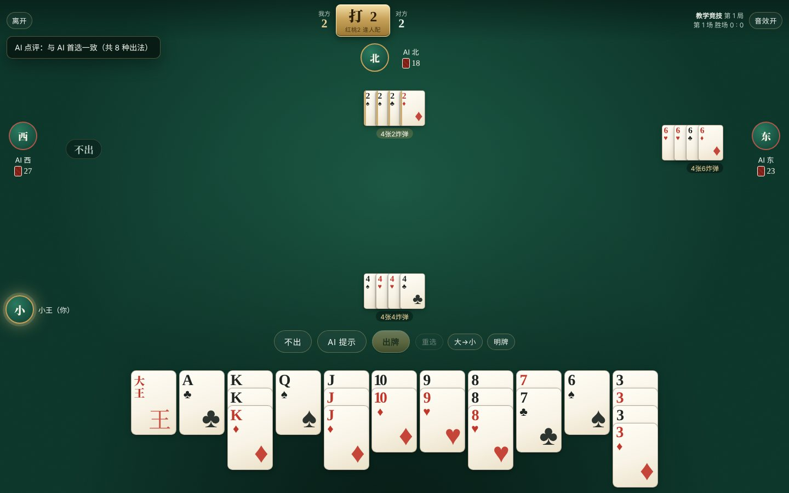
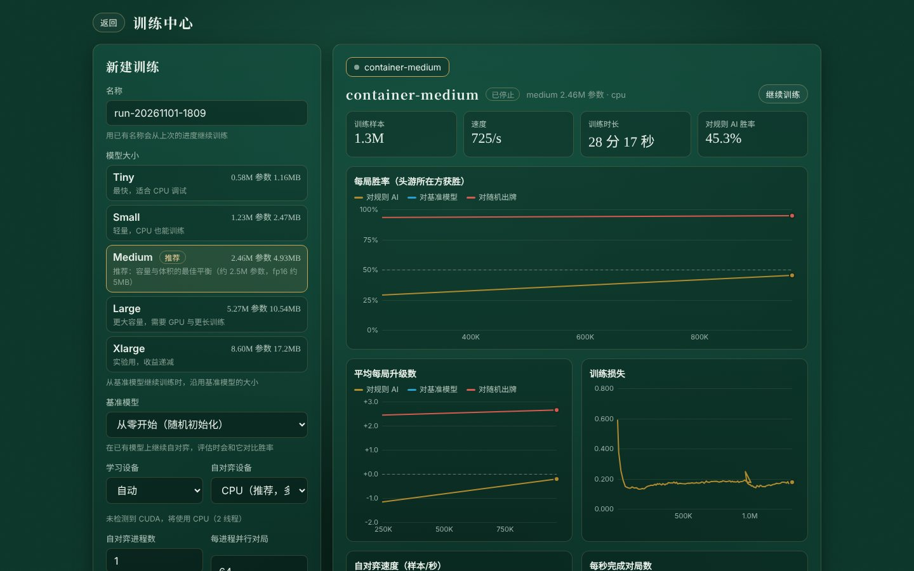
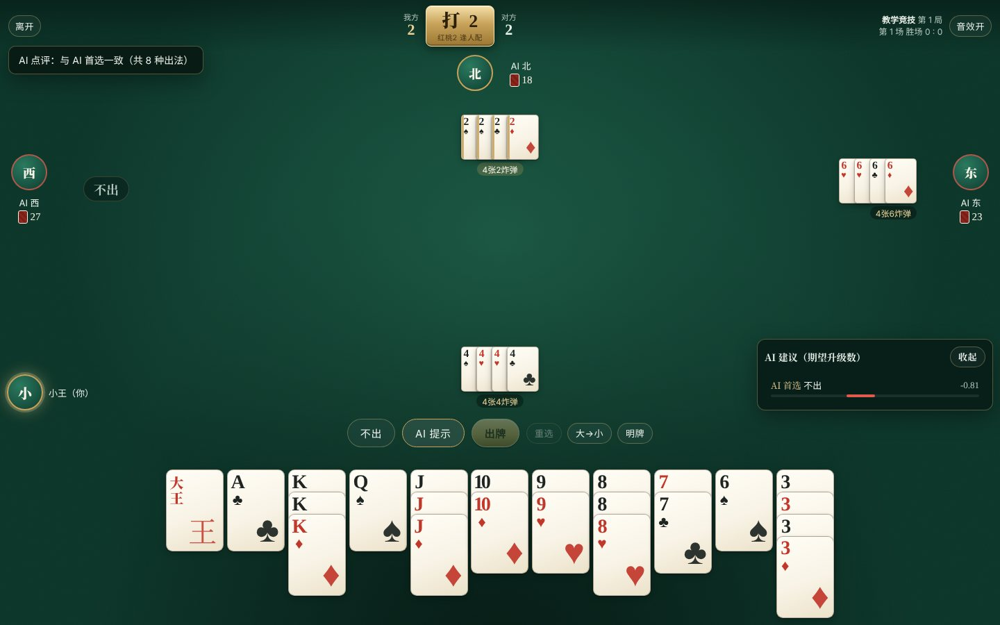
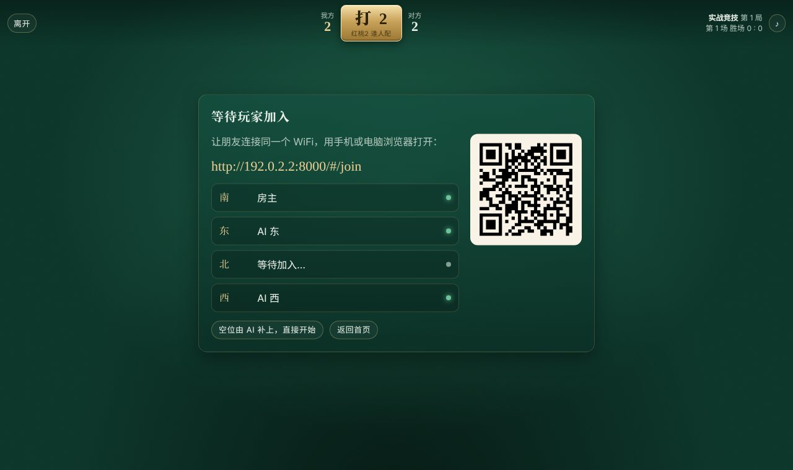
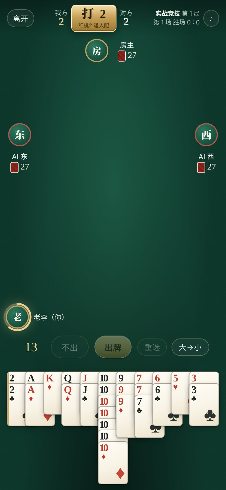

# 掼蛋 AI（guandan-rl）

**中文** · [English](README.en.md)

完全靠**自我对弈强化学习**训练出来的掼蛋 AI，附带一个能在浏览器里用的训练中心和牌桌：可以看着胜率曲线训练模型，也可以和 AI 学牌、对战，同一 WiFi 下的手机和电脑还能一起上桌。

界面支持中文（默认）和英文，在首页右上角点“中文 / English”切换，每台设备分别记住。



## 功能

- **完整的掼蛋规则**：逢人配、三带二、顺子、三连对、钢板、各类炸弹、同花顺、天王炸，进贡 / 还贡 / 抗贡、接风、双上升三级、过 A、打 A 三次不过退回 2。详见 [规则说明](docs/RULES.md)。
- **纯强化学习**：深度蒙特卡洛（DMC）自对弈，不用任何人类棋谱或手写策略训练。每个 AI 只能看到自己的手牌和公开的出牌记录。v1.10.2 随包模型是加宽后的 large 网络（551 万参数，自对弈 79 亿局面），在 30,000 副新复式牌上对 v1.10.1 每局多赢 0.070 级，对 v1.9.0 每局多赢 0.485 级（胜率 57.7%），对规则 AI 胜率 92.4%。详见 [训练说明](docs/TRAINING.md) 和 [模型说明](docs/MODEL.md)。
- **辅助任务训练**：训练时让网络顺便预测其他三家的手牌（参考开源的 DanLM / DanKS），实测比普通训练每局多赢约 0.4 级。
- **推演搜索（实验）**：出牌前随机推测对手手牌、把网络认为最好的几手在 24 个“可能的世界”里推演下去。对训练不久的模型很有用，对随包模型反而略差，因此默认关闭。
- **复式评估**：评估时每副牌打两遍、双方交换座位，并给出误差范围，模型之间的差距不会被牌运淹没。
- **计分倍数（快速对局可选）**：只算升级 / 标准倍数（6 张以上炸弹、同花顺、天王炸翻倍）/ 全炸翻倍，牌桌实时显示倍数。
- **高性能**：规则引擎、合法出牌生成和特征编码都用 Rust 编写（单核每秒 6–10 万次决策），PyTorch 负责网络；有显卡时自对弈和学习都在 GPU 上（混合精度、显存内回放池）。
- **训练中心**：选择模型大小（推荐 medium，约 2.5M 参数、5 MB）、从零开始或在基准模型上继续训练，实时查看对规则 AI / 基准模型 / 随机出牌的胜率曲线、损失和速度。
- **对战**
  - **教学模式**：你和三个 AI。不限时，可以让 AI 给出前五个出牌建议（带期望升级数），每次出牌后 AI 会点评，还可以明牌看所有人的牌。
  - **实战模式**：任意组合 AI 和真人。每步限时 20 秒，超时随机出一手合法的牌；看不到别人的牌，自己出完后可以看队友的牌。
  - **快速对局**（随机级牌、单局结算）或 **竞技模式**（从 2 打到 A）。
  - **局域网联机**：其他人用同一 WiFi 下的手机或电脑扫码 / 打开网址即可加入。
  - **安卓 App**：手机上装一个 App 就能打，手机本身当主机，朋友扫码用浏览器加入。
  - **随打随停、多桌同时进行**：离开牌桌（或手机切到后台）就自动暂停，回来从原处接着打；可以同时开最多 8 桌，首页统一查看、加入、暂停或关闭。
  - **权限**：运行游戏的电脑是房主，管理所有牌桌和训练中心；其他设备只能管理自己开的牌桌。可以设房主密码，让手机也能当房主。
- 发牌、出牌、炸弹、进贡、名次、升级都有动画和音效，手机横竖屏都能用。

| 训练中心 | 教学模式（AI 提示） |
|---|---|
|  |  |
| **局域网等人（扫码加入）** | **手机上打牌（实战模式 20 秒计时）** |
|  |  |

## 安装

### Windows 免安装版（只打牌，最简单）

从 [Releases](https://github.com/wlx7/guandan-rl/releases) 下载 `guandan_windows.exe`（约 32 MB），双击就能打牌和局域网联机，不用安装 Python 或任何依赖。

- 它不带 PyTorch，用 numpy 运行随包模型（出牌与完整版完全一致），所以**不能训练**；想训练请用下面的完整安装版。
- 数据（加入的模型、模型名称）放在 exe 旁边的 `guandan_data` 文件夹。把 exe 放进完整安装版的文件夹（例如 `D:\guandan`），就能用那里训练出来的模型对战。
- 第一次运行时 Windows 可能提示“Windows 已保护你的电脑”，点“更多信息 → 仍要运行”；防火墙询问时勾选“专用网络”，手机才能连进来。
- 关闭黑色窗口即退出。每次启动要先解压几秒。

### 安卓手机

从 [Releases](https://github.com/wlx7/guandan-rl/releases) 下载 `guandan_android.apk` 安装（允许浏览器安装未知来源应用）。打开就能和 AI 打牌，手机本身就是局域网主机：同一 WiFi 的朋友扫码用浏览器加入，不用装 App。和免安装版一样只能对战、不能训练。详见 [安卓版说明](docs/ANDROID.md)。

### Windows 完整安装版（可以训练）

1. 从 [Releases](https://github.com/wlx7/guandan-rl/releases) 下载 `install_windows.bat`、`install_windows.ps1`、`start_windows.bat`、`train_windows.bat`，放进同一个文件夹（例如 `D:\guandan`）。
2. 双击 `install_windows.bat`。它会自动：
   - 安装 [uv](https://github.com/astral-sh/uv) 和 Python 3.12。从 v1.5.1 起，Python、下载缓存、虚拟环境（`.venv`）和训练数据（`guandan_data`）**全部放在这个文件夹里**，不会占用 C 盘（CUDA 版 PyTorch 约 5 GB，建议放在空间充足的盘）；
   - 检测 NVIDIA 显卡并安装对应的 **CUDA 版 PyTorch**（依次尝试 cu126 / cu124 / cu121 / cu118，失败自动换国内镜像，没有显卡则装 CPU 版）；
   - 安装本程序（含训练好的模型）。
3. 双击 `start_windows.bat`，浏览器会自动打开 `http://127.0.0.1:8000`。

第一次启动时 Windows 防火墙会询问是否允许 Python 访问网络，请勾选“专用网络”，局域网里的其他设备才能连进来。从网上下载的 `.bat` 如果被 SmartScreen 拦下，点“更多信息 → 仍要运行”。

安装时的输出保存在 `install_log.txt`。以后有新版本，再双击一次 `install_windows.bat` 即可升级（已装好的 PyTorch 会被跳过）。不想要了，直接删除整个文件夹即可。

### Linux / macOS

```bash
python3 -m venv .venv && . .venv/bin/activate
pip install torch                      # 按 https://pytorch.org 选择合适的 CUDA 版本
pip install guandan_rl-*.whl           # 从 Releases 下载对应平台的 wheel
guandan serve
```

### 从源码构建

需要 Rust（`rustup`）和 Python 3.9+：

```bash
git clone https://github.com/wlx7/guandan-rl && cd guandan-rl
pip install maturin torch
maturin build --release && pip install target/wheels/*.whl
guandan serve
```

## 使用

### 局域网联机

1. 主机上点“开一桌”，选**实战模式**，把要给朋友坐的座位设为“玩家”，点“开桌”。
2. 牌桌会显示局域网地址和二维码（例如 `http://192.168.1.8:8000/#/join`）。朋友连上同一个 WiFi，用手机扫码或在浏览器打开这个地址，选座位、填昵称即可加入。
3. 所有玩家到齐后自动发牌。对家是你的队友。

断线后重新打开页面会自动回到原来的座位。

### 出牌操作

- 点选手牌，或在手牌上**按住拖动**连续选择；**双击**一列选中同点数的所有牌；右键或“重选”清空。
- 回车 = 出牌，空格 = 不出，Esc = 取消选择。
- 一手牌有多种打法时（例如 7 7 7 + 两张逢人配，可以当 5 张炸弹也可以当三带二），会弹出让你选择。

### 训练

打开“训练中心”，选择模型大小、基准模型和并行进程数，点“开始训练”。训练在后台进程中进行，关掉浏览器页面不影响；用同一个名称再次开始会从上次的进度继续。

- **每个训练是一个独立的文件夹** `guandan_data/runs/<名称>/`（名称默认是开始时间）。里面的 `model.pt` 是这个训练最新的模型（每 5 分钟自动保存），`model_<样本数>k.pt` 是每小时的快照，`ckpt_latest.pt` 用于继续训练。
- 开桌时“AI 模型”下拉框里会直接列出「训练 <名称>：model.pt」等文件；点“加入模型库”可以复制一份并起个好记的名字。
- 显卡和内存只够同时运行**一个**训练，已有训练在跑时不能再开新的。自对弈进程数和并行对局数会按本机显存、内存自动限制。
- 点“停止训练”后会先保存模型再退出；1 分钟内没有响应会自动强制结束，也可以手动点“强制结束”。

随包模型的训练情况见 [模型说明](docs/MODEL.md)。

也可以不开界面，直接用命令行或双击 `train_windows.bat`：

```bash
python -m guandan.train --name main --preset medium
```

### 命令行一览

```
guandan serve [--port 8000]         启动界面（默认监听所有网卡，供局域网访问）
guandan train ...                   训练（参数见 python -m guandan.train -h）
guandan eval model.pt --opponent rule --rounds 2000
guandan info                        显示 GPU、模型大小预设和已有模型
```

数据（训练记录、模型库）默认保存在 `~/guandan_data`，Windows 一键安装版保存在安装文件夹的 `guandan_data`，免安装版保存在 exe 旁边的 `guandan_data`，可用环境变量 `GUANDAN_HOME` 修改。

## 项目结构

```
src/                 Rust 规则引擎（PyO3 扩展 guandan._core）
  cards.rs           牌、级牌、逢人配、随机数
  moves.rs           牌型识别（含逢人配的所有解释）与合法出牌生成
  game.rs            整场比赛状态机：发牌、进贡还贡抗贡、接风、升级、过 A
  features.rs        观测编码（只用当前玩家可见的信息）
  venv.rs            批量环境（自对弈与评估）
  bot.rs             规则 AI（只用于评估，不参与训练）
python/guandan/
  model.py           Q 网络与模型大小预设
  train.py           DMC 自对弈训练（多进程 actor + GPU learner + 评估进程）
  evaluate.py        对战评估
  agents.py          推理封装
  server/            FastAPI + WebSocket 对战服务器与训练管理
  web/               前端（原生 JS，无需构建）
android/server/      安卓版的牌桌服务器（Rust：房间逻辑、HTTP/WebSocket、网络推理，与 Python 版协议相同）
android/app/         安卓外壳（全屏 WebView + 前台服务）
scripts/             Windows 一键安装 / 启动 / 训练脚本
tests/               Rust 与 Python 测试
```

更多技术细节见 [架构说明](docs/ARCHITECTURE.md)。

## 测试

```bash
cargo test --release --no-default-features   # 规则引擎
pytest tests                                  # 绑定、训练环境、服务器与 WebSocket 对局
```

## 许可

MIT
