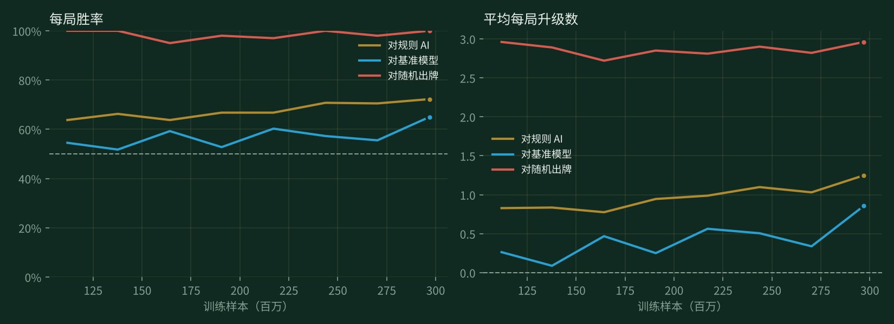

# 随包模型说明

`guandan-medium.pt`（安装后显示为“内置：guandan-medium.pt”）是用本项目的训练程序、从随机初始化开始纯自对弈训练出来的模型，没有用任何人类对局或手写策略。

从 v1.10.0 起，随包模型是 **large** 尺寸（5,518,405 参数，fp16 存储 11 MB）。文件名仍是 `guandan-medium.pt`，以兼容已有的设置和训练中心里的“内置模型”。

## v1.11.0 实测

v1.11.0 仍是同一个 large 网络，从 v1.10.5 的权重出发，用 TD(λ) 目标（λ = 0.9）继续自对弈，先后在 vast.ai 和 AutoDL 的 2×RTX 4090 上累计约 99 亿样本；自对弈总样本 190.8 亿。中途把探索方式从“2% 完全随机出牌”改成“0.5% 完全随机 + 1.5% 在网络认为最好的 3 手里随机”（`--epsilon 0.005 --epsilon-top 0.015 --top-k 3`），同样训练量下每局多赢 0.033 ± 0.007 级。发布权重是最后 4 个快照（32.6 / 34.4 / 36.3 / 38.2 亿样本，最后一段训练的计数）的等权平均。下表都是从未参与筛选的牌：

| 对手 | 测试 | v1.11.0 成绩 |
|---|---|---|
| v1.10.5 发布版 | 30,000 副复式牌（60,000 局，`--seed 20261112`） | 每局 **+0.161 ± 0.006** 级，胜率 **52.96% ± 0.14** |
| v1.10.5 发布版 | 2,048 场完整比赛（1,024 副起手牌各打两遍、交换座位，共 24,234 局） | 赢 **1,194 场（58.3% ± 1.0）** |
| v1.9.0 发布版 | 30,000 副复式牌（与前几版验收同一批牌） | 每局 +0.661 ± 0.006 级，胜率 60.43% ± 0.15（v1.10.5 为 +0.514、57.66%） |
| 规则 AI | 4,000 副复式牌 | 每局 +2.493 级，胜率 92.91%（同一批牌上 v1.10.5 为 +2.458、92.17%） |

这一版对上一版的提升（每局 +0.161 级）是 v1.10 系列里最大的一次，单局胜率也高了近 3 个百分点。

### 残局搜索（v1.11.0 新增）

AI 出牌时，当四家手里的牌加起来剩 20 张以内（“深度思考”模式下 24 张），会按网络对其他三家手牌的预测（辅助任务的“手牌预测头”）抽样 16 种（32 种）可能的牌局，在每一种里用 alpha-beta 把所有合法出牌**精确算到本局结束**（`src/endgame.rs`，四家都明牌、都按最优打），取平均结果最好的一手；不比网络自己的选择好就仍出网络的牌。同一个模型、开与不开残局搜索对打：

| 设置 | 测试 | 开残局搜索的一方 |
|---|---|---|
| 普通模式：剩 20 张，16 种牌局 | 2,000 + 2,000 副复式牌（两批不同的牌） | 每局 +0.018 ± 0.006 级、+0.034 ± 0.006 级 |
| 深度思考：剩 24 张，32 种牌局 | 1,000 副复式牌 ×2 | 每局 +0.029 ± 0.013 级、+0.045 ± 0.012 级 |
| 剩 20 张，48 种牌局 | 1,500 副复式牌 | 每局 +0.034 ± 0.007 级（再多牌局也不更好） |
| 剩 20 张，**均匀**抽样手牌（不用网络的预测） | 4,000 副复式牌 | 每局 **−0.035** ± 0.006 级 |

- 残局时第一名（头游）通常已经出来了，所以残局搜索多赢的是级数，单局胜率基本不变（49.8%～50.1%）。
- 抽样手牌必须用网络的预测：均匀抽样的世界离真实牌局太远，精确解反而把 AI 带偏。
- 桌面电脑上最慢的一步约 0.25 秒（深度思考约 1 秒）；手机上会慢几倍。

### 原来的“深度思考”推演搜索不再使用

原来的推演搜索（`search.py`：抽样手牌后让网络往下打十几步、再用网络估值）在 v1.11.0 的网络上和不搜索的同一网络对打每局输 **1.5 级以上**，连“只看一步”都输 1.6 级。原因是它拿**下一个出牌人**的网络估值来比较自己的候选：两个玩家看到的信息不同，同一局面的估值平均相差 0.62 级，而好的候选之间通常只差 0.1 级左右。网络越强、候选越接近，这个误差越致命。“深度思考”改为更早、更多牌局的残局搜索；`python -m guandan.evaluate --search` 仍保留，供实验。

## v1.10.5 实测

v1.10.5 从 v1.10.2 的权重出发，改用 **TD(λ) 目标**（λ = 0.9，见[训练说明](TRAINING.md)里“TD(λ) 目标”一节）再自对弈 12.2 亿样本（RTX 4090 上 3 小时），其余设置不变；自对弈总样本 91.5 亿。发布权重是最后 4 个快照的等权平均。下表都是从未参与筛选的牌：

| 对手 | 测试 | v1.10.5 成绩 |
|---|---|---|
| v1.10.2 发布版 | 30,000 副复式牌（60,000 局，`--seed 20261112`） | 每局 **+0.058 ± 0.006** 级，胜率 **50.72% ± 0.14** |
| v1.10.2 发布版 | 2,049 场完整比赛 | 赢 1,052 场（51.3% ± 1.1），单局胜率 50.4% |
| 用原方法（纯 DMC）从 v1.10.2 练了 13.1 亿样本的模型 | 30,000 副复式牌（`--seed 20261113`） | 每局 **+0.026 ± 0.006** 级，胜率 49.60% ± 0.14 |
| v1.9.0 发布版 | 30,000 副复式牌（与前几版验收同一批牌） | 每局 +0.514 ± 0.006 级，胜率 57.66% ± 0.15（v1.10.2 为 +0.485、57.69%） |
| 规则 AI | 4,000 副复式牌 | 每局 +2.458 级，胜率 92.19%（v1.10.2 为 +2.457、92.41%） |

这一版多赢的主要是**级数**而不是局数：对 v1.10.2 的单局胜率只高 0.7 个百分点，对纯 DMC 的对照模型甚至低 0.4 个百分点，但赢的时候升得更多（更多双上、一三游）。训练目标本来就是每局的级差；完整比赛的胜率提升（51.3%）在这个样本量下还不显著。

## v1.10.2 实测

v1.10.2 仍是同一个 large 网络、同样的设置，自对弈总样本从 52.8 亿增加到 79.3 亿（RTX 5090 累计约 18 小时）。发布权重是最后 4 个快照（72.7 / 74.8 / 77.1 / 79.3 亿样本）的等权平均。下表都是从未参与筛选的牌：

| 对手 | 测试 | v1.10.2 成绩 |
|---|---|---|
| v1.10.1 发布版 | 30,000 副复式牌（60,000 局，`--seed 20261112`） | 每局 **+0.070 ± 0.006** 级，胜率 **50.99% ± 0.14** |
| v1.10.1 发布版 | 2,048 场完整比赛 | 赢 **1,091 场（53.3% ± 1.1）**，单局胜率 50.8% |
| v1.9.0 发布版 | 30,000 副复式牌（与前两版验收同一批牌） | 每局 +0.485 ± 0.006 级，胜率 57.69% ± 0.15（v1.10.1 为 +0.408、56.67%） |
| 规则 AI | 4,000 副复式牌 | 每局 +2.457 级，胜率 92.41%（v1.10.1 为 +2.426、91.77%） |

接着上一节的训练过程（同一批 10,000 副筛选牌，对 v1.9.0，最近 4 个快照的平均）：

| 自对弈样本 | 52.8 亿（v1.10.1） | 59.3 亿 | 66.0 亿 | 72.7 亿 | 77.1 亿 | 79.3 亿（v1.10.2） |
|---|---:|---:|---:|---:|---:|---:|
| 对 v1.9.0 | +0.403 | +0.435 | +0.444 | +0.445 | +0.457 | +0.462 |

- **进步继续放缓但没有停**：这一段每 10 亿样本约 +0.02 级（上一段约 +0.03）。
- **多条线分开训练再合并，收益很小。** 另一台机器的两张 RTX 4090 从 v1.10.1 权重出发各自训练了 13.7 亿样本，水平与主线相同（对 v1.9.0 +0.446 / +0.449，主线同期 +0.444）；训练到 9.8 亿样本时把三条线的权重平均，只比单条线多约 0.005 级。上一节里“两条线平均后高约 0.02 级”是在降低了学习率的两条线上测的，不能推广。所以之后只保留一条主线。

## v1.10.1 实测

v1.10.1 接着训练 v1.10.0 的同一个 large 网络（沿用同一个优化器状态和学习率 5e-5），自对弈总样本从 37.4 亿增加到 52.8 亿（RTX 5090 累计约 12 小时）。发布权重仍是最后 4 个快照（46.2 / 48.4 / 50.6 / 52.8 亿样本）的等权平均。下表都是从未参与筛选的牌：

| 对手 | 测试 | v1.10.1 成绩 |
|---|---|---|
| v1.10.0 发布版 | 30,000 副复式牌（60,000 局，`--seed 20261112`） | 每局 **+0.057 ± 0.006** 级，胜率 **51.29% ± 0.14** |
| v1.10.0 发布版 | 2,048 场完整比赛 | 赢 **1,079 场（52.7% ± 1.1）**，单局胜率 51.5% |
| v1.9.0 发布版 | 30,000 副复式牌（与 v1.10.0 验收同一批牌） | 每局 +0.408 ± 0.006 级，胜率 56.67% ± 0.15（v1.10.0 为 +0.344、55.12%） |
| 规则 AI | 4,000 副复式牌 | 每局 +2.426 级，胜率 91.77%（v1.10.0 为 +2.423、91.40%） |

接着上一节的训练过程（同一批 10,000 副筛选牌，对 v1.9.0）：

| 自对弈样本 | 单个快照 | 最近 4 个快照的平均 |
|---:|---:|---:|
| 37.4 亿（v1.10.0） | +0.307 | +0.354 |
| 39.6 亿 | +0.294 | +0.367 |
| 41.8 亿 | +0.305 | +0.380 |
| 44.0 亿 | +0.306 | +0.371 |
| 46.2 亿 | +0.318 | +0.385 |
| 48.4 亿 | +0.326 | +0.381 |
| 50.6 亿 | +0.368 | +0.403 |
| 52.8 亿（v1.10.1） | +0.313 | +0.403 |

- **还在进步，但变慢了**：每多 10 亿样本，快照平均约提高 0.03 级（v1.10.0 之前约 0.05 级）。
- **降低学习率没有帮助。** 在另一台双 RTX 4090 上，从 33.0 亿样本的快照平均出发，用 2e-5 和 1e-5 各训练 11.8 亿样本，快照平均分别为 +0.362 和 +0.366，不如原学习率继续训练的 +0.371～+0.385。
- **两条独立训练线的权重可以直接平均。** 上面两条从同一起点出发、分开训练的线，把它们的快照平均再平均，得到 +0.381，比各自高约 0.02 级。

## v1.10.0 实测

v1.10.0 把 v1.9.0 的 medium 网络加宽成 large（Net2Net：开局时和 v1.9.0 打法完全一样），再纯自对弈 37.4 亿个决策（RTX 5090 上约 8.5 小时，每秒约 12 万样本），发布权重是最后 4 个快照（相隔 30 分钟，30.8 / 33.0 / 35.2 / 37.4 亿样本）的等权平均。下表都是从未参与筛选的牌：

| 对手 | 测试 | v1.10.0 成绩 |
|---|---|---|
| v1.9.0 发布版 | 30,000 副复式牌（60,000 局） | 每局 **+0.344 ± 0.006** 级，胜率 **55.12% ± 0.15** |
| v1.9.0 发布版 | 2,049 场完整比赛（从 2 打起、有进贡还贡、直到打过 A） | 赢 **1,447 场（70.6% ± 1.0）**，单局胜率 55.7% |
| 规则 AI | 4,000 副复式牌 | 每局 +2.423 级，胜率 91.40%（v1.9.0 为 +2.261、89.56%） |

误差为一个标准误，复式牌以每副牌为单位估计。对 v1.9.0 的复式结果用 `--seed 20261111 --batch 512`，对规则 AI 用 `--seed 11082 --batch 128`（与下文 v1.9.0 的测法相同）。作为对比，v1.9.0 对 v1.8.2 是每局 +0.048 级。

训练过程（同一批 10,000 副筛选牌，对 v1.9.0）：

| 自对弈样本 | 单个快照 | 最近 4 个快照的平均 |
|---:|---:|---:|
| 2.2 亿 | −0.017 | |
| 6.6 亿 | +0.082 | |
| 11.0 亿 | +0.099 | |
| 22.0 亿 | +0.120 | |
| 24.2 亿 | +0.203 | +0.254 |
| 30.8 亿 | +0.267 | +0.305 |
| 37.4 亿 | +0.307 | +0.354 |

- **模型容量是 medium 停滞的原因。** medium 练到 17.7 亿样本就不再进步；同样的方法换成 large，37 亿样本时仍在上涨。
- **快照平均很有效。** 相邻快照的成绩上下波动约 ±0.04 级，把最近几个快照的参数取平均，比其中最好的单个快照还高约 0.05 级。
- **xlarge（893 万参数）没有更好。** 在另一台 RTX 4090 上同样从 v1.9.0 加宽、同样的设置，相同样本量下与 large 基本持平（11 亿样本时 +0.095 对 +0.099），每个样本还慢约 40%，所以选 large。
- **成对微调（v1.9.0 用的方法）在这一轮无效**：在 v1.9.0 上再做一轮，以及在 large 的快照平均上做，几十个候选都在 ±0.03 级的噪声内。

## v1.9.0 实测

v1.9.0 从 v1.8.2 权重出发，仅微调动作评分头。下表使用随机级牌的单局，每副牌双方交换座位各打一次，所有玩家只使用网络。胜率按头游所属队伍计算。

| 对手 | 副数 | v1.9.0 胜率 | 平均每局净升级 |
|---|---:|---:|---:|
| v1.8.2 发布版 | 30,000 | 50.695% | +0.0477 |
| 规则 AI | 4,000 | 89.56% | +2.261 |
| v1.6.1 发布版 | 4,000 | 54.15% | +0.276 |

对 v1.8.2 的结果来自固定候选之后的独立验收。以每副牌为单位估计，胜率的近似 95% 区间为 50.42%～50.97%，净升级为 +0.036～+0.059。另测从 2 开始、带进还贡、一直打过 A 的完整比赛，512 个开局分别换边，共胜 513/1,024 场，整场胜率的近似 95% 区间为 47.4%～52.8%。

复现单局验收时，下载 v1.8.2 的 `guandan-medium.pt` 命名为 `v1.8.2.pt`，用以下命令评测。副牌的生成也取决于批大小。对另两位对手使用 `--deals 4000 --seed 11082 --batch 128`，相同牌上 v1.8.2 分别取得 89.09% 和 53.79%。

```bash
python -m guandan.evaluate guandan-medium.pt --opponent v1.8.2.pt --deals 30000 --batch 128 --device cuda --seed 8093741
```

训练命令见[成对微调说明](TRAINING.md)。发布权重取级差目标第 80、112、144、176、192 轮快照的等权平均，保存为 fp16，再以 2∶1 权重与胜负目标第 48 轮快照平均。运行时仍是一个 medium 网络。

## v1.8.2 基准模型的训练记录

| 项目 | 数值 |
|---|---|
| 模型大小 | medium，2,463,745 参数（另有 166,212 参数的手牌预测头，只在训练时使用），fp16 存储 5.3 MB |
| 训练样本 | 约 17.7 亿个决策：前 8.84 亿是普通自对弈（最后 2.28 亿加了“预测其他三家手牌”的辅助任务），之后 8.9 亿在辅助任务权重 1.0 和自动调参中练出（最后 3 小时批大小 4096，最后 1.5 小时学习率 5e-5） |
| 训练时长 | 约 15.3 小时（RTX 3060 笔记本，GPU 自对弈 3 进程 × 256 局，每秒约 3.5 万样本） |
| 对规则 AI（只用网络） | 每局胜率 89.1%，平均每局 +2.25 级 |
| 对 v1.6.1 随包模型 | 每局胜率 54.9%，平均每局 +0.28 级 |

以上都是复式对局（2000 副牌，每副牌打两遍、双方交换座位）。对这个模型，推演搜索反而会让成绩变差，所以对战默认只用网络出牌（见 [训练说明](TRAINING.md#推演搜索ai-深度思考)）。



训练曲线是第四段训练（从 v1.4.1 模型继续、加辅助任务）中每 15 分钟一次的复式评估，每次用同一批 200 副牌；“对基准模型”是对 v1.4.1 模型。之后几段的对比见 [训练说明](TRAINING.md#自动调参实验爬山法)。

同类方法（DouZero / DanZero）通常要训练几天、几十亿样本才接近收敛，这个模型还远没有练到头。想要更强的 AI，在训练中心选“基准模型：内置 guandan-medium.pt”继续训练即可，评估曲线会同时显示新模型对它的胜率。

评估方法见 [训练说明](TRAINING.md#评估怎样看胜率曲线)。
